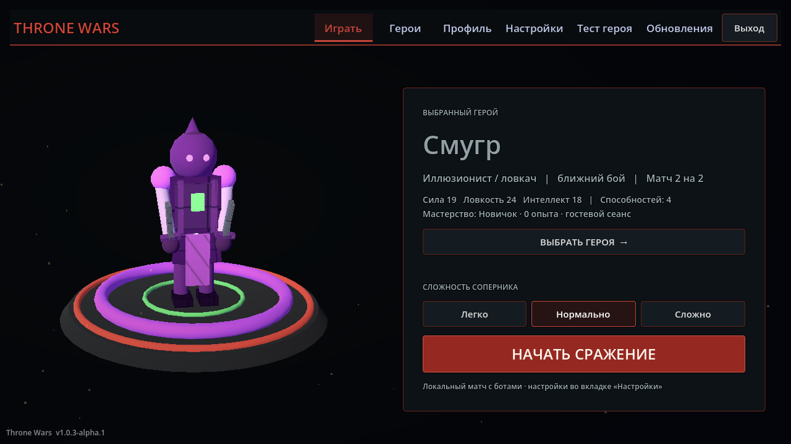

# Throne Wars BETA



Небольшая офлайн-MOBA на Godot: выберите героя, развивайтесь в бою, помогайте союзнику и разрушьте вражеский трон.

**Версия:** 1.0.3-alpha.1 — публичный прототип в разработке. Цель баланса: матчи 10–15 минут. Готовность сборки и реальные результаты проверок публикуются в [отчёте](docs/VALIDATION.md); наличие исходников не означает, что все критерии альфы пройдены.

## Начать играть

Готовая проверенная Windows-сборка появится в [Releases](https://github.com/respexs001/Throne-Wars-BETA/releases), когда будут закрыты критерии выпуска. Если раздел пуст, готового публичного релиза ещё нет.

Распакуйте ZIP и запустите `ThroneWars.exe`. Godot для игровой сборки не нужен. На первом экране нажмите **«Играть гостем»** или создайте локальный профиль. Гостевой прогресс существует до выхода из игры; профиль сохраняет статистику и мастерство на устройстве. Сетевой регистрации и мультиплеера нет.

## Основной режим

- 2×2: один игрок с союзным ботом против двух ботов.
- Основные герои: Titan, Pyromancer, Ranger и Смугр.
- Три линии, башни, магазин, руны и Древний Страж.
- За Стража команда получает прежние награды и две усиленные осадные волны.
- Две рекомендуемые сборки на героя; косметическое мастерство не усиливает характеристики.
- Остальные герои, 1×1 и 5×5 включаются в настройке «Экспериментальные режимы и герои». Их баланс не гарантирован.

## Управление

| Действие | Клавиши |
|---|---|
| Движение / атака | ПКМ по земле / врагу |
| Выбрать юнита | ЛКМ |
| Способности | Q, W, E, D, F; ультимейт R |
| Предметы | Z, X, C, V, B, N |
| Магазин / таланты | F4 / G |
| Камера на героя / фиксация | Пробел / Y |
| Атака с перемещением / стоп / удержание | A / S / H |
| Таблица игроков / пауза | Tab / Esc |

Обучение первого матча показывает основные действия и может быть закрыто в любой момент.

## Запустить исходники

1. Установите **Godot 4.7.2 standard**, без .NET.
2. Скачайте или клонируйте этот репозиторий.
3. Импортируйте `project.godot` в Godot, дождитесь импорта ресурсов.
4. Нажмите F5 и выберите гостевой вход.

Кэш `.godot` не нужен: движок создаст его сам. Файлы `.uid` и `.import` исходных ресурсов сохраняются в Git. Поддерживаемый для первой альфы игровой пакет — Windows x64; другие экспортные пресеты экспериментальны.

## Разработка и проверка

Нужен Python 3.11+ и Godot 4.7.2:

```powershell
python tools/test.py --godot "C:/path/to/Godot.exe" --suite core
python tools/test.py --godot "C:/path/to/Godot.exe" --suite acceptance --workers 3
python tools/build_windows.py --godot "C:/path/to/Godot.exe" --templates "C:/path/to/4.7.2.stable"
python tools/test_windows.py "build/windows/ThroneWars-1.0.3-alpha.1-candidate.zip"
```

Все тестовые данные изолируются временным APPDATA/XDG-каталогом. Не запускайте старые внешние проверочные сценарии над настоящими аккаунтами.

- [Сборка](docs/BUILD.md)
- [Известные проблемы](docs/KNOWN_ISSUES.md)
- [План развития](docs/ROADMAP.md)
- [Локальные аккаунты](docs/LOCAL_ACCOUNT_SECURITY.md)
- [Ассеты и атрибуция](THIRD_PARTY_NOTICES.md)

## Права

Исходники опубликованы для просмотра, без открытой лицензии. Права сохраняются за автором проекта `zenagolev0-hub`. Проверенные бинарные альфа-сборки разрешены для бесплатного личного тестирования; отдельное разрешение на использование кода и ассетов не выдаётся. См. [RIGHTS.md](RIGHTS.md). Зависимости сохраняют собственные лицензии.
